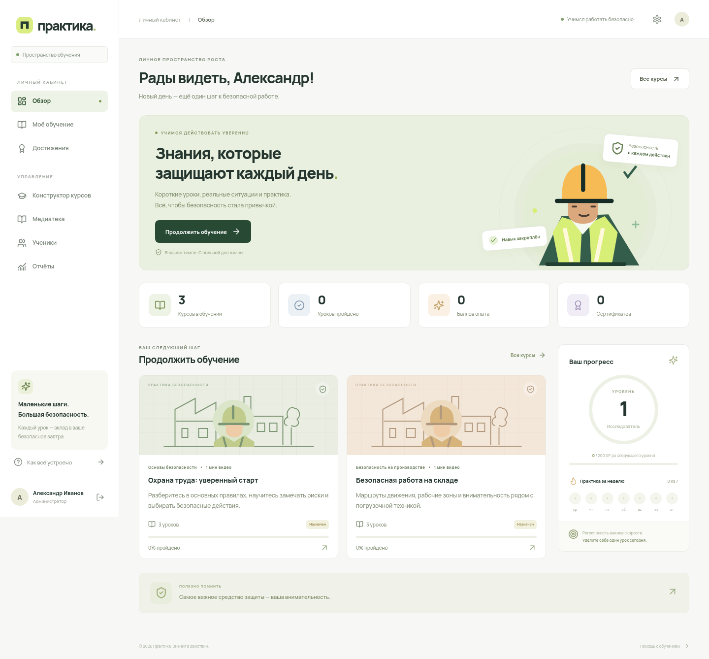

# Практика — платформа обучения охране труда

Рабочая первая версия LMS для собственного VPS и домена. Интерфейс на русском языке, адаптирован для компьютера, планшета и телефона.



## Что реализовано

- Кабинеты администратора и ученика; самостоятельная регистрация и создание пользователей администратором.
- Курсы, назначения, самостоятельная запись на открытые курсы, черновики и публикация. Опубликованные и начатые курсы можно редактировать с сохранением результатов учеников.
- Загрузка видео частями по 8 МиБ с продолжением после обрыва. Повторно выберите **тот же файл** в том же браузере. Незавершённые загрузки можно отменить в медиатеке.
- Постоянная очередь обработки в PostgreSQL, отдельный FFmpeg worker, HLS 360p/720p, обложки. Поддерживаются MP4, современные MOV, WebM и MKV; качество ограничивается разрешением исходника.
- Собственный интерфейс плеера: пауза, перемотка, звук, качество, скорость 0,5–2×, полный экран, картинка в картинке при поддержке браузером. Сохранение позиции и учёт просмотра.
- Конструктор тестов: вопросы, 2–8 вариантов ответа, один правильный ответ, пояснения, проходной процент, видео и фотография перед вопросами.
- Конструктор визуальных упражнений: загрузка собственного изображения, выделение нескольких безопасных зон, настройка начального положения работника, перемещение мышью, касанием или клавиатурой. Проверяется точка под ногами персонажа.
- Серверная проверка заданий, повторные попытки, баллы опыта, уровни, достижения и сертификат прохождения курса с печатью в PDF.
- Отчёты по назначениям, прогрессу и результатам, экспорт CSV. Управление пользователями, сброс пароля и отключение аккаунтов.
- Docker Compose, HTTPS через Caddy, постоянные тома, скрипты согласованного резервного копирования и восстановления.

Сертификат подтверждает прохождение курса на платформе. Это не ЭЦП, не протокол комиссии и не автоматическое выполнение всех требований законодательства к обучению по охране труда.

## Стек

| Компонент     | Решение                                                              |
| ------------- | -------------------------------------------------------------------- |
| Интерфейс     | React 19, TypeScript, Vite, локальные шрифты Manrope                 |
| API           | Node.js 24 LTS, Fastify 5, Zod                                       |
| Данные        | PostgreSQL 17, параметризованные SQL-запросы                         |
| Видео         | FFmpeg, H.264/AAC, HLS, hls.js; нативный HLS в совместимых браузерах |
| Изображения   | Sharp, повторное кодирование в WebP                                  |
| Развёртывание | Docker Compose, Caddy 2, Let's Encrypt                               |
| Проверки      | Node test runner, Playwright + Chromium                              |

[Архитектура и ограничения](docs/ARCHITECTURE.md) · [Развёртывание на SpaceWeb](docs/SPACEWEB.md) · [Работа администратора](docs/ADMIN.md)

## Локальная разработка

Нужны Node.js 24, Docker с Compose v2, FFmpeg/ffprobe. Для CI или сервера используйте Dockerfile. Каждый облачный сеанс уже изолирован: работайте в существующем checkout, дополнительный Git worktree не нужен.

```bash
npm ci
docker compose -f compose.dev.yaml up -d --wait
cp .env.example .env
npm run db:migrate
npm run seed:demo
npm run dev
```

Затем, в другом терминале, когда worker обработает демонстрационный ролик:

```bash
npm run demo:publish
```

Откройте локально порт Vite 5173. API использует порт 3000. Vite проксирует `/api` — отдельный CORS не нужен. Если доступ к dev-серверу идёт через другой адрес, задайте `APP_URL` равным его origin; после изменения перезапустите API.

Тестовые аккаунты **только для локальной демонстрации**:

| Роль          | Почта                   | Пароль             |
| ------------- | ----------------------- | ------------------ |
| Администратор | `admin@praktika.test`   | `DemoAdmin2026!`   |
| Ученик        | `student@praktika.test` | `DemoStudent2026!` |

Демонстрационные курсы и ролик служат примерами интерфейса; замените их утверждёнными материалами. Демо-команды запрещены при `NODE_ENV=production`. На боевой сервер демо-пользователи не создаются.

Для обычной пустой dev-базы вместо демоданных задайте `ADMIN_EMAIL` и `ADMIN_PASSWORD` в локальном `.env`, затем запустите API. Инициализация создаёт администратора только при отсутствии такого email и никогда не сбрасывает существующий пароль.

## Проверки

Интеграционные тесты очищают **отдельную** БД, имя которой обязано заканчиваться `_test`. Основная база не используется.

```bash
docker compose -f compose.dev.yaml exec db createdb -U praktika praktika_test
npm run typecheck
npm test
npm run build
npx playwright install chromium
npm run test:e2e
npm audit
```

Для системного Chromium задайте `PLAYWRIGHT_CHROMIUM_EXECUTABLE_PATH=/usr/bin/chromium`. Браузерные тесты требуют локальную демобазу и опубликованные демонстрационные курсы. Playwright запустит `npm run dev`, если сервер ещё не запущен. Для другой тестовой БД задайте `TEST_DATABASE_URL`.

## Большие видео и VPS 2 CPU / 2 ГБ / 50 ГБ

Объём файла не связан с лимитом памяти сервера: одновременно передаётся только одна часть. Но «любой объём» не может быть безграничным на диске 50 ГБ. По умолчанию лимит одного файла **10 ГиБ**, резерв свободного места **2 ГиБ**, обработка одного видео одним потоком и максимум 720p. Перед загрузкой нужен запас примерно на два размера исходника плюс резерв; реальный размер HLS зависит от содержимого.

Исходник удаляется только после успешной обработки. Неудачный исходник сохраняется для ручного повтора; неиспользуемые материалы можно удалить из медиатеки. Незавершённые загрузки удаляются после 7 суток без активности. Оригиналы храните отдельно, если они нужны для архива.

С ростом видеотеки нужны дополнительный диск или отдельное объектное хранилище. Интеграция S3/CDN в эту версию не включена. Лимит можно поднять через `UPLOAD_MAX_BYTES`, но сначала обеспечьте место. 1080p включается `MAX_VIDEO_HEIGHT=1080` при достаточных ресурсах. Не увеличивайте число worker-процессов на VPS 2 ГБ.

## Структура

```text
server/             API, авторизация, SQL, очередь и обработка видео
web/                Интерфейс, плеер, конструктор, визуальные задания
scripts/            Настройка, резервное копирование и восстановление
deploy/Caddyfile    HTTPS и reverse proxy
compose.yaml        Боевой запуск
compose.dev.yaml    PostgreSQL для разработки
tests/              Интеграционные и браузерные проверки
docs/               Архитектура, SpaceWeb и инструкции
```

## Пределы первой версии

Платформа не включает оплату, SCORM/xAPI, видеоконференции, прокторинг, несколько изолированных организаций, SMTP-проверку почты и автоматическое восстановление пароля по email. Саморегистрация открыта по умолчанию и регулируется `REGISTRATION_OPEN`. Сброс пароля делает администратор; пользователь меняет пароль в настройках.

Учёт просмотра помогает проходить обучение последовательно, но не доказывает присутствие человека у экрана. Доступ к видео ограничен авторизацией и назначением курса; DRM и запрет записи экрана не реализованы. Нагрузочные испытания на реальном VPS и подключение вашего домена выполняются после развёртывания.
