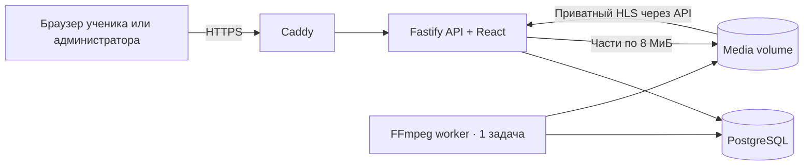
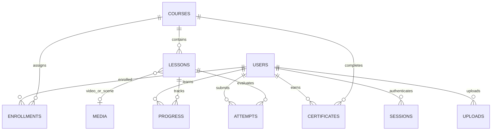

# Архитектура

Один репозиторий и один собираемый Docker-образ для API и worker. Frontend раздаётся API из `dist/client`. Очередь лежит в PostgreSQL, поэтому Redis не расходует память VPS. Видео хранится в Docker volume; в Git и PostgreSQL бинарные файлы не попадают.

## Основные сущности

- Роли: администратор управляет материалами и пользователями; ученик видит опубликованные открытые и назначенные курсы.
- Самостоятельная регистрация создаёт только ученика. Отключается `REGISTRATION_OPEN=false`. Почта в этой версии не подтверждается через SMTP.
- Открытый курс виден в каталоге; доступ к материалам появляется после записи. Закрытый курс назначает администратор.
- Для теста хранятся вопросы, ответы и проходной процент. Для визуального упражнения — изображение, инструкция, нормализованные координаты прямоугольника и пояснение. Ответы и целевая зона исключаются из API ученика.
- Попытки проверяются сервером. Прогресс уникален по паре ученик–урок. Баллы начисляются один раз: видео 30, тест 50, визуальная практика 75. Уровень — каждые 200 XP.
- Сертификат выпускается сервером только после завершения всех уроков курса; уникален по паре ученик–курс.
- Нельзя менять программу уже начатого курса. «Новая версия» копирует курс и уроки с новыми идентификаторами; история старого курса сохраняется.
- Администратор может удалить любой курс после явного подтверждения, включая начатые и завершённые. Каскадные внешние ключи атомарно удаляют его уроки, назначения, прогресс, попытки и сертификаты. Баллы курса исчезают вместе с прогрессом. Общие медиафайлы и другие курсы сохраняются.

## Видео

1. Администратор создаёт upload session, сервер проверяет лимит и запас диска.
2. Браузер читает `File.slice()` и отправляет части с `Upload-Offset`. В памяти находится только одна часть.
3. Смещение фиксируется в транзакции под блокировкой строки. Файл синхронизируется до записи смещения. При восстановлении лишний хвост после незавершённой транзакции обрезается.
4. Браузер хранит ID сеанса и отпечаток размера, имени, времени изменения, первых и последних 64 КиБ. После обрыва выберите исходный файл в том же браузере. Это механизм поиска сеанса, не криптографическое доказательство неизменности всего файла.
5. После получения всех байтов media-задача попадает в PostgreSQL. Worker берёт одну задачу с `FOR UPDATE SKIP LOCKED`, обновляет lease каждые 20 секунд. Задачу после аварии можно подобрать через 2 минуты; после трёх аварий или ошибки обработки доступен ручной повтор.
6. Worker проверяет сигнатуру контейнера, использует принудительный MP4/MOV либо Matroska/WebM demuxer и файловый протокол без доступа к сети. Создаёт H.264/AAC HLS и постер. Варианты не повышают исходное вертикальное разрешение. Размеры кадра ограничены 8K, длительность — 7 суток; тайм-аут одной команды кодирования — 6 часов. Для более длинных задач потребуется расширение worker.
7. До статуса `ready` материалы недоступны. После него исходник удаляется; HLS и постер раздаются API с проверкой доступа для каждого запроса.
8. Видеоплеер отправляет интервалы просмотра; сервер ограничивает прирост прошедшим временем и скоростью. Простая перемотка к концу не завершает урок. При скорости 2× учитывается просмотр в ускоренном темпе. Не является прокторингом.

В текущей версии нет S3, CDN или аппаратного кодирования. Обработка больших роликов на 1 CPU может занять значительное время. Лимит исходника не гарантирует достаточность места для любого содержимого: следите за диском и очередью.

## Защита и эксплуатация

- Scrypt с отдельной солью, случайные непрозрачные сессии. В БД хранится хеш сессионного токена. Cookie: HttpOnly, SameSite=Lax, Secure в production.
- CSRF-токен для мутаций авторизованного пользователя и проверка Origin. API и frontend используют один origin.
- Ограничения частоты логина, регистрации и запросов; серверные роли, валидация Zod, параметризованный SQL.
- База и API не публикуют порты в боевом Compose; наружу доступны только Caddy 80/443. Поэтому production API доверяет proxy headers от внутренней сети.
- Изображения ограничены 10 МиБ и 32 мегапикселями, перекодируются в WebP. SVG от пользователей не принимается.
- Пути медиа формируются из UUID; имена исходников не используются в файловых путях. Ответы не содержат паролей или токенов БД. CSV защищает текстовые ячейки от формул.
- Требуются регулярные обновления образов, резервные копии БД **и** media, внешний мониторинг, учёт требований к персональным данным вашей организации. Данные не отправляются внешним сервисам аналитики.
- PostgreSQL — источник постоянного состояния. Миграция начальной схемы повторяема и выполняется под advisory lock. Последующие изменения схемы следует добавлять отдельными версионными миграциями; автоматического down-migrate нет.

Контейнеры ограничены 384 МиБ для API, 768 МиБ для worker, 256 МиБ для PostgreSQL и 96 МиБ для Caddy. Остальная память остаётся ОС. Значения — стартовая конфигурация, не результат нагрузочных испытаний на SpaceWeb.
